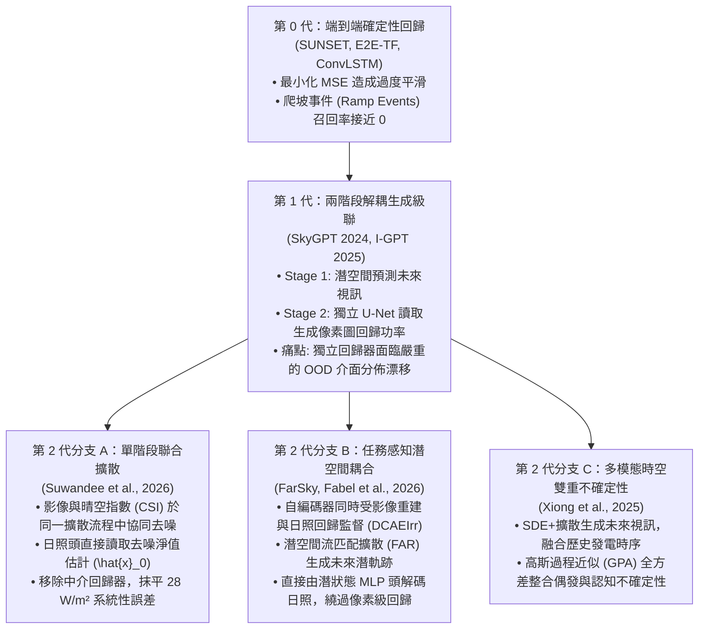

# 天空影像生成式太陽光電/日照機率預測之技術演進樹 (Generative Solar Forecasting Evolution)

> **建立日期**：2026-11-23（全面更新於 2026-11-24）  
> **涵蓋核心文獻**：  
> 1. [[2024-nie-skygpt|SkyGPT (Nie et al., 2024)]]  
> 2. [[2025-xiong-multimodal-diff-transformer|Xiong et al. (2025)]]  
> 3. [[2025-pan-igpt-two-stage|I-GPT (Pan & Lim, 2025)]]  
> 4. [[2026-huang-pv-mm-diffusion|PV-MM-Diffusion (Huang et al., 2026)]]  
> 5. [[2026-suwandee-single-stage-diffusion|Single-Stage Joint Diffusion (Suwandee & Suwanwimolkul, 2026)]]  
> 6. [[2026-fabel-farsky|FarSky: Task-Aware Latent Coupling (Fabel et al., 2026)]]

---

## 1. 核心技術範式演進：從像素級聯到潛空間耦合 (The Paradigm Evolution)

天空影像超短期（Nowcasting, 0–30 分鐘）日照/光電預報在 2024 至 2026 年間迅速經歷了四代技術範式的迭代與爭鳴：

---

## 2. 核心學術痛點：兩階段級聯的「介面分佈漂移 (Interface Domain Shift)」

2026 年的兩篇前沿論文（[[2026-suwandee-single-stage-diffusion|Suwandee et al.]] 與 [[2026-fabel-farsky|Fabel et al.]]）從不同角度共同證實了早期兩階段級聯模型（如 SkyGPT）的核心病灶：
- **獨立回歸器是基於「真實無噪影像」訓練的**；
- 推論時餵給它由生成模型合成的未來天空圖，即使肉眼看起來高度逼真，高維特徵中細微的紋理漂移與失真會被獨立回歸器大幅放大，導致嚴重的**系統性負向偏差（Negative Bias / Underestimation）**：
  - 在 SIRTA 測試集上，獨立回歸器讀取合成圖的 RMSE 較聯合讀取高出 **28.1 $W/m^2$**；
  - 在 PSA 西班牙測試集上，解耦基準 FAR 的系統偏差（MBE）高達 **-35 至 -44 $W/m^2$**！

### 兩大破局解法之對比：
1. **Suwandee et al. (像素級單階段)**：既然回歸器讀生成圖會漂移，乾脆**廢除獨立回歸器**，讓日照頭在擴散每一步讀取無噪的未來天空估計值（$\hat{x}_0$）。
2. **FarSky (潛空間級多任務)**：既然解碼為像素圖再預測會漂移，乾脆**在潛空間直接解碼**！讓自編碼器在壓縮時就學會日照特徵，擴散生成未來潛狀態後直接由 MLP 頭輸出日照，根本不需要還原成像素圖再做回歸。

---

## 3. 六大頂尖生成預報模型橫向對比矩陣 (Master Comparison Matrix)

| 評比維度 | SkyGPT (2024) | I-GPT (2025) | Xiong et al. (2025) | PV-MM-Diffusion (2026) | Suwandee et al. (2026) | FarSky (2026) |
| :--- | :--- | :--- | :--- | :--- | :--- | :--- |
| **範式類型** | 兩階段級聯 (解耦) | 兩階段級聯 (解耦) | 兩階段多模態級聯 | **端到端多模態聯合擴散** | **單階段聯合像素擴散** | **任務感知潛空間耦合** |
| **生成核心** | VQ-VAE + Transformer | 軸向 VQ-VAE + Transformer | Conv-GRU + Neural SDE + CDM | **Coupled U-Net 雙分支去噪** | Stable Diffusion 1.5 + ControlNet | **DCAEIrr + FAR 流匹配潛擴散** |
| **物理/引導機制**| 單尺度 PhyCell (線性 PDE)| **多尺度 PhyCell** (3x3, 5x5, 7x7)| Neural SDE 連續漂移擴散 | **隨機位移 RS-PV-MMA 注意力** | **去噪淨值估計 ($\hat{x}_0$) 條件化** | **潛空間多任務日照監督 ($\mathcal{L}_{irr}$)** |
| **日照/功率輸出** | 獨立 U-Net (空間加權) | **IP-U-Net (加 Attention Gate)** | 多模態 Transformer + GPA | **擴散同步生成 1D PV 序列** | **聯合 CSI 擴散頭** | **共享潛狀態 MLP 頭直接解碼** |
| **輸入模態** | 純天空圖 | 純天空圖 | 多模態 (天空圖 + 歷史功率) | **空幀佔位自適應 (全模態/純圖/純數值)**| 純天空圖 + 時間特徵 | 純天空圖 (可外加日照) |
| **爬坡檢測能力** | 中等 (~0.38) | 優良 (~0.50) | 優良 (~0.55) | **極佳 (WS 21.46 kW 超越理論上限)** | **強烈相關 ($r=0.85$, CRPSS +0.44)** | **極高 (F1 > 0.61~0.67, Recall > 80%)** |
| **推論速度與算力**| A100: 50 樣本 32 秒 | **RTX 4090: 10 樣本 0.5 秒 (最快)**| 擴散採樣較慢 | DPM-Solver++ 60步: 10 樣本 45 秒 | 50 步反向擴散較慢 (1.98億參數) | 4 條潛軌跡流匹配推論適中 |
| **主要評測案場** | Stanford 30kW 屋頂 | Stanford 30kW 屋頂 | Stanford 30kW + 新疆奎屯 | **Stanford 30kW 屋頂** | 法國 SIRTA 氣象觀測站 | **西班牙 PSA 太陽能平台 (雙測試集)** |

---

## 4. 當前學術關鍵共識與研究前沿

1. **生成式模型的不可替代性在於「極端爬坡（Ramp Events）」**：
   - 如果只比全體平均 RMSE，以均方誤差訓練的端到端模型（如 SUNSET 或 E2E-TF）往往看似名列前茅；
   - 但 FarSky 與 Suwandee 的深入評估一致指出：**端到端模型在爬坡事件時 F1 分數趨近於 0**，因為它們為了平均分數選擇平滑掉陡峭的突變；唯有隨機生成式模型（Diffusion / I-GPT）能重現多模態雲遮階躍，提供真實電網所需的動態備載區間。
2. **潛空間耦合（Latent Coupling）vs. 像素聯合擴散（Pixel Co-denoising）**：
   - Suwandee 證明了像素級單階段擴散能達到極限的 CRPS 精度；
   - FarSky 則證明了潛空間直接解碼（Direct Latent Decoding）具有極高的運算效率與極低的系統偏差，且保留了視覺解釋性。
3. **終極前沿：端到端物理-輻射聯合強化**：
   - 未來研究的聚焦點將是如何把「多尺度物理動力學（I-GPT 的 Multi-scale PhyCell）」、「任務感知潛空間（FarSky 的 DCAEIrr）」與「單階段條件化（Suwandee 的 $\hat{x}_0$）」融合為一套終極架構。
